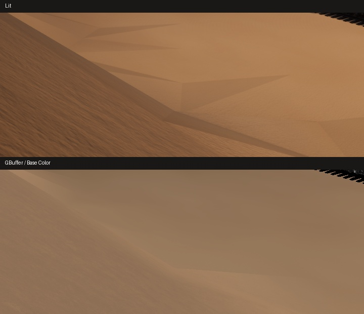

# Columns 735 м · две границы на песке

Два кадра из одного запуска DX11/SM5, 1440×810, неподвижная камера Mammoth. В обоих показан один и тот же участок 720×285 пикселей. Сверху заметен центральный треугольник; в буфере базового цвета его контур почти исчезает. Среднее абсолютное расхождение яркости обычного кадра с прежним эталоном составило 0,47 уровня из 255.

| Граница | Lit | Base Color | Base Color на параллельных линиях в ±18 px |
|---|---:|---:|---:|
| Верхний наклонный край | −8,41 | +1,39 | +0,50 и +0,96 |
| Левая короткая сторона | +3,47 | 0,00 | −0,09 и +0,14 |

Значения — медианный перепад экранной яркости между полосами по сторонам границы, шкала 0–255. В буфере цвета у первого края перепад слабый и противоположного знака, у второго исчезает. На этих двух отрезках базовый цвет не объясняет выраженный контур в обычном кадре. Результат оставляет открытыми вклад освещения и геометрических теней. Проверка диагностическая, исправление ещё не испытано.
