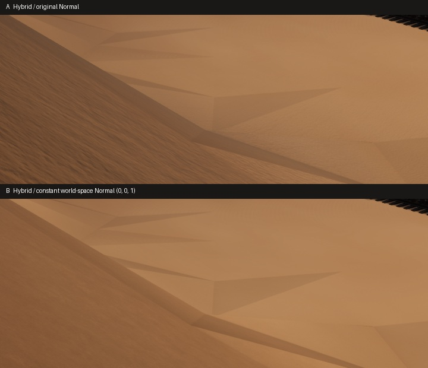

# Columns sand facets at 735 m

A uses the original Hybrid material. B sets its final world-space Normal to (0, 0, 1). Both images come from the same stationary train and camera during one DX11/SM5 session at 1440 × 810. Eight nearby Landscape components reported the requested parameter in both states. Terrain LOD, light and the other material outputs use the same settings.

Fine surface relief changes in B. The central triangular patch and its diagonal boundary remain visible. Across two preselected segments, the absolute median luminance differences were 8.45 and 3.48 levels in A, and 8.40 and 5.00 in B (0–255). On the same crop, A matched the earlier reference within 0.05 levels of mean absolute luminance difference.

The final Normal replacement did not remove the facets. These still frames do not distinguish slope-driven base color from geometric shadowing or other shading terms. This is a diagnostic result. The production scene keeps its existing material.
