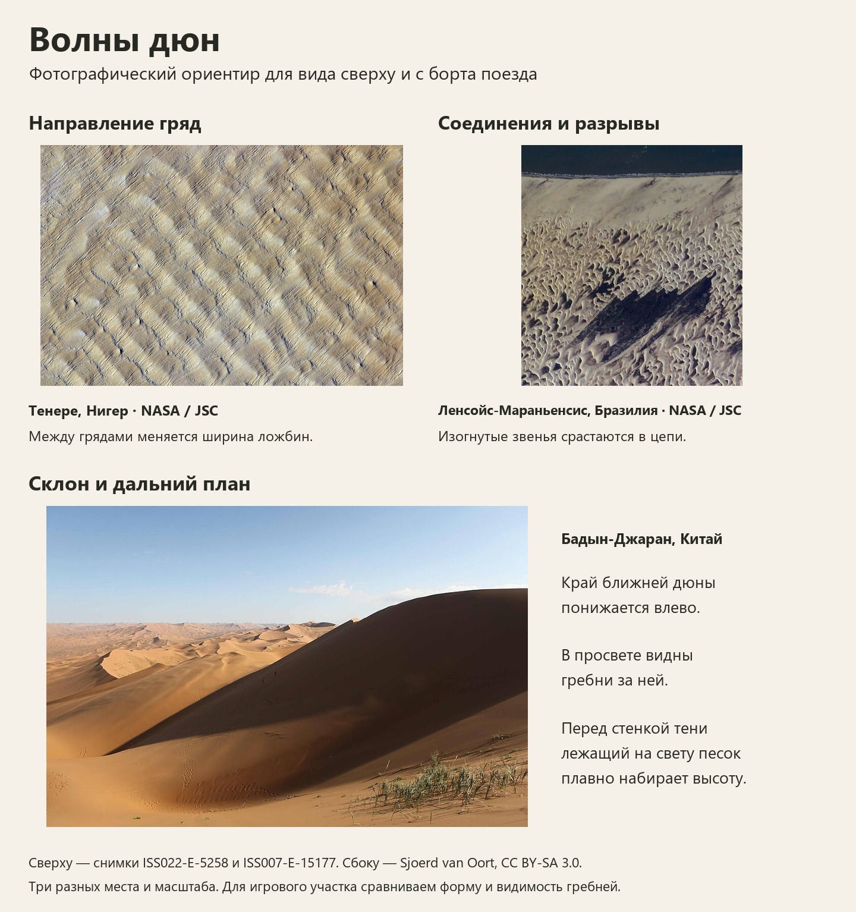

# Волны дюн — рабочий фотоэталон 1.0

Эталон для композиции волн вдоль железной дороги в пустынной сцене. В нём три настоящие фотографии разных мест. Песок, цвет и дневной свет игры оцениваются отдельными сравнениями. На орбитальных снимках уверенно читается рисунок поля. Высоту и крутизну игрового склона измеряем по рельефу в Unreal.

## На что смотреть

- **Сверху.** Проследить один гребень вдоль нескольких изгибов. Соседняя линия подходит к нему, часть звеньев соединяется, затем ложбина расширяется. Ширина открытого песка и места затухания меняются вдоль пути. В Тенере крупные поперечные гряды довольно симметричны; здесь они служат ориентиром для плана поля. На бразильском снимке видны дуги, соединяющиеся в протяжённые цепи. Тёмные междюнные участки местами заняты водой. [Тенере, снимок NASA](https://science.nasa.gov/earth/earth-observatory/sand-dunes-in-the-tenere-desert-niger-42070/) · [Ленсойс-Мараньенсис, снимок NASA](https://science.nasa.gov/earth/earth-observatory/coastal-dunes-brazil-3889/)
- **Сбоку.** В Бадын-Джаране ближняя кромка выражена, меняет высоту и опускается к ложбине. Через понижение видны следующие гребни. Для профиля со срывом песка полезно различать протяжённый наветренный подъём и более короткое подветренное лицо. Эту асимметрию применяют к локальным участкам, где она оправдана формой. [Бадын-Джаран, фото Sjoerd van Oort](https://commons.wikimedia.org/wiki/File:Small_Dunes_of_Badain_Jaran_Desert.JPG) · [Описание профилей, National Park Service](https://www.nps.gov/subjects/geology/aeolian-landforms.htm)
- **Из Mammoth.** Показываем один общий план поля и боковой проезд. Проверяем, как ближнее плечо подходит к пути и какую часть дальней дюны открывает седловина по ходу движения. Расстояние до основания, высоту гребня и уклон сверяем на одних и тех же поперечных профилях. Контроль №68Б уже открывает дальнюю форму к концу короткого отрезка. В следующей паре оцениваем также непрерывность и изменчивость гребней. [Игровая последовательность №68Б](https://raw.githubusercontent.com/netstormcomua/WorldsOfTrains-VisualReviews/05113c46ac2e37eda55f33ed1000cc5b88438f2b/VisualReviews/WorldGenerator/DuneSaddle68B/images/sequence.jpg)

## Авторство

Тенере — NASA/JSC, экипаж Expedition 22, ISS022-E-5258, 1 декабря 2009. Бразилия — NASA/JSC, ISS007-E-15177, 21 сентября 2003. Использованы опубликованные NASA изображения Земли. [Правила использования материалов NASA](https://www.nasa.gov/nasa-brand-center/images-and-media/)

Бадын-Джаран — Sjoerd van Oort, *Small Dunes of Badain Jaran Desert*. Фотография входит также в доску M27.2. [Страница автора и файла](https://commons.wikimedia.org/wiki/File:Small_Dunes_of_Badain_Jaran_Desert.JPG) · [Лицензия CC BY-SA 3.0](https://creativecommons.org/licenses/by-sa/3.0/)

Для этой доски фотографии уменьшены пропорционально и снабжены подписями. Компоновка доски распространяется по [CC BY-SA 3.0](https://creativecommons.org/licenses/by-sa/3.0/). Права и условия для каждой фотографии указаны выше.
