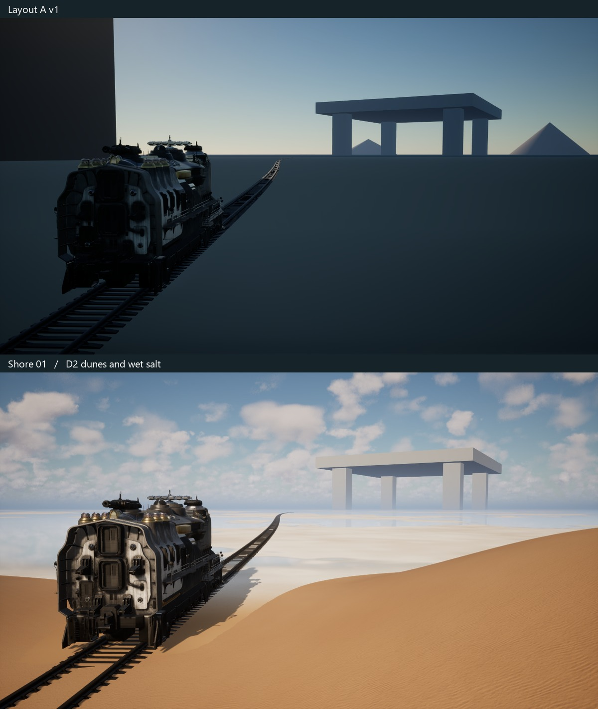
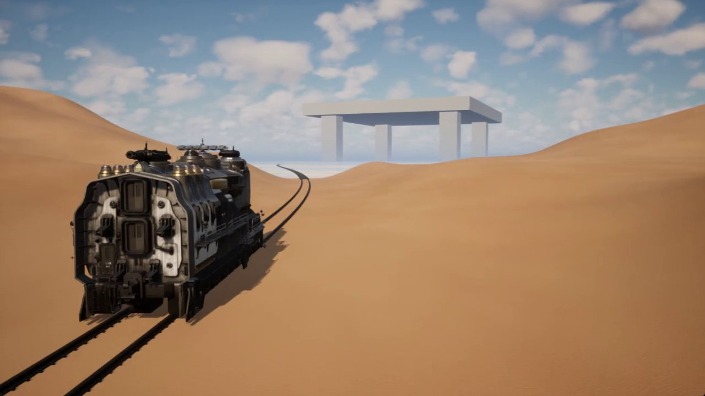
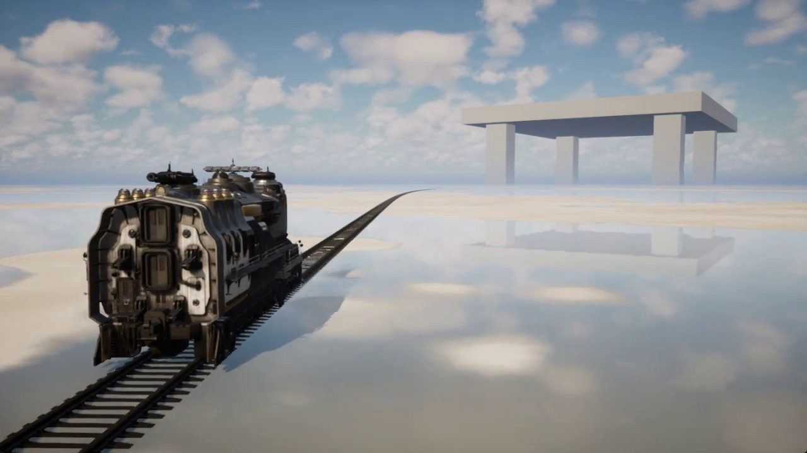

# Shore 01 · Dunes to wet salt

7 November 2026. A driveable scene study on the western entrance to the Columns branch. The Mammoth emerges between D2 dune slopes and crosses a shallow salt pan. The original platform and pillars mark the far side.

[Watch the continuous 25-second DX11 drive](shore-drive.mp4)

The before image comes from a fresh take in the original Layout A v1. Both images use the same train transform, camera position, rotation and 64° field of view at 735 m along Columns. The separate scene uses the original spline points, native rail mesh and Mammoth profile.

Four archived D2 heightfield tiles from field-m27.3.2 supply the dune shapes. They are rotated and blended against the railway clearance and the shore, with Hybrid Sand v2 and the D2 daylight rig. Salt preset 710261 defines connected wet patches and dry islands. A mirrored scene capture supplies the actual sky and distant columns. The render target updates at 15 Hz. The salt and shore treatment covers this view, and the platform remains a scale proxy.

The real-time run covered 1122 m in 32.0 s. All 49 ground probes along the take passed. Frame time reached 37.9 ms at p95 and 47.6 ms at maximum. The silent window recording contains 629 source frames at 25.2 fps and 121 held frames in the 30 fps encode. The train starts in motion for the shot. This review covers the pictured segment in editor-game DX11. Artistic approval is pending.
