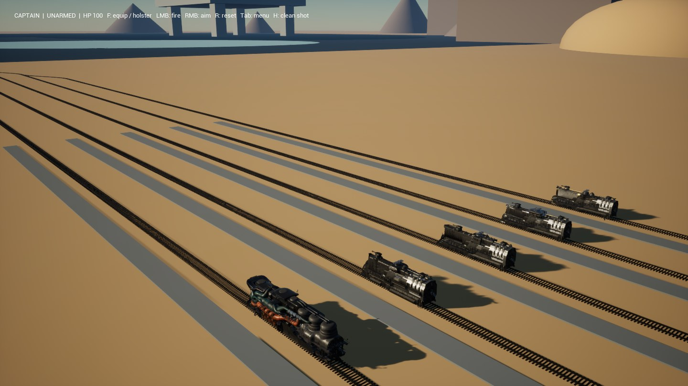
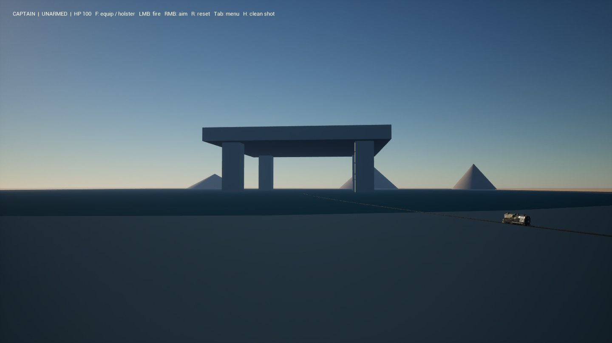
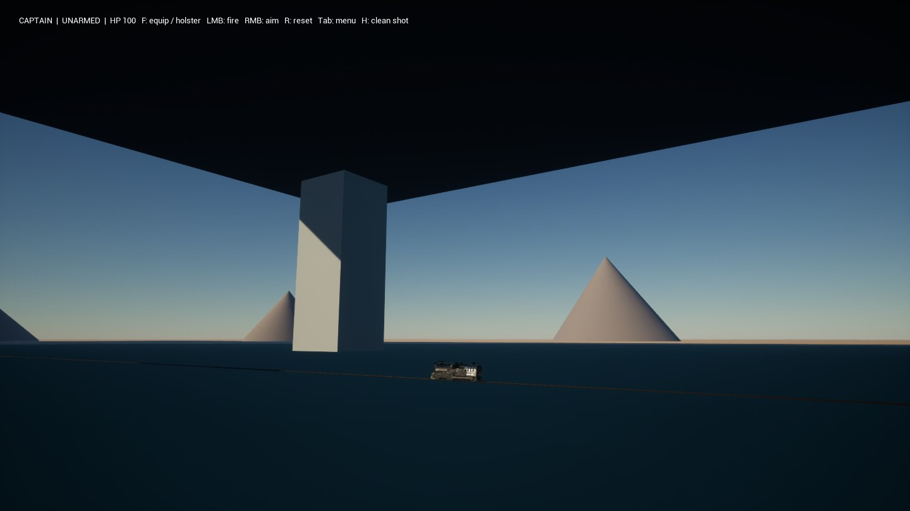
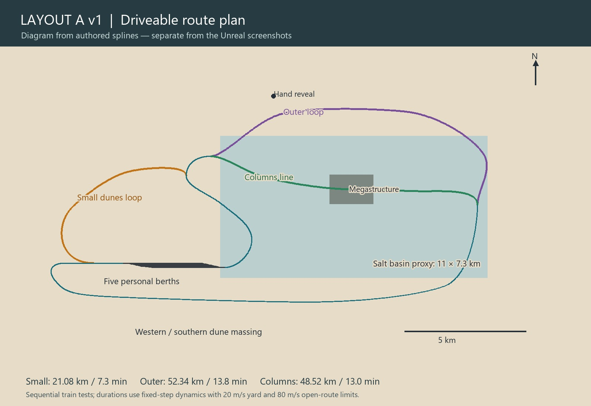
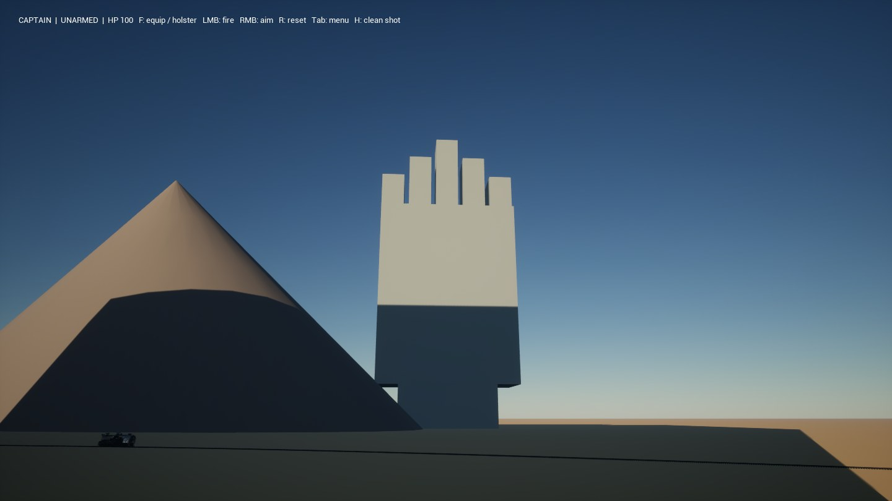
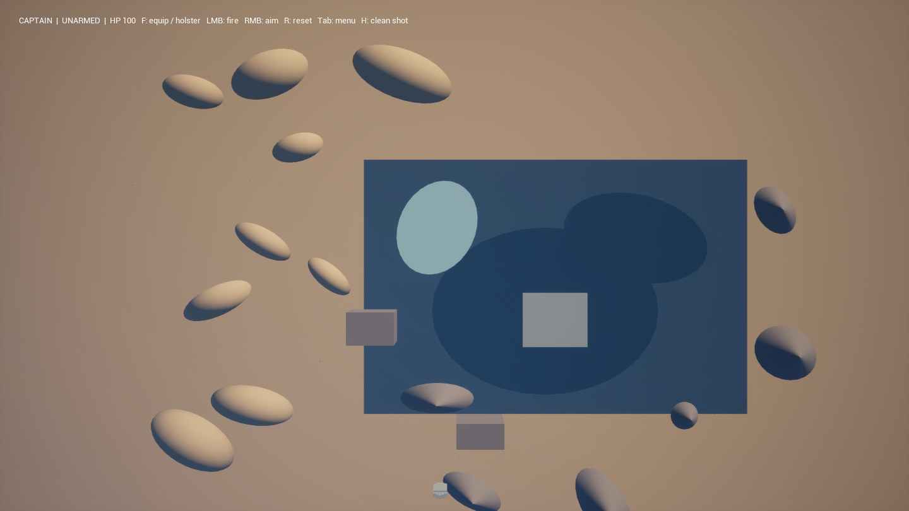

# Layout A v1 — driveable scale blockout

6 November 2026. Technical review candidate; artistic approval has not been granted.

An isolated desert layout with five existing trains, separate station entry/exit, three forward closed routes and automatic routing/braking into each train's own berth. Scenery is deliberately primitive massing, not a finished landscape or a new generator.

| Route | Measured full journey | Fixed-step simulated travel time |
|---|---:|---:|
| Small dunes loop | 21.07–21.08 km | 7.3–7.3 min |
| Outer loop | 52.34–52.34 km | 13.8–13.8 min |
| Columns line | 48.51–48.52 km | 13.0–13.0 min |

The 15 full journeys use the real Railway dynamics at fixed time steps, accelerated for validation. They are not real-time performance measurements. Checks cover the selected branch, own berth, stop accuracy, exit, reboarding/redeparture, reset, occupied-entry waiting/resumption and switch locking. Separate loads preserve all 21 track identities. Collision rays check the hidden/revealed hand viewpoints.

The separate DX11 real-time run travelled 3493 m in 55.0 s. Reported frame times: p95 17.83 ms, p99 18.40 ms, maximum 114.35 ms. The train was positioned for the column shot before the measured drive; there is no repositioning during the measured drive. Reset and exit were checked afterwards. This is an editor-game test, not a packaged build. The clip is silent.

## Selected Unreal views

[Real-time columns drive](columns-drive.mp4)

## Limits and review questions

- Dunes, mountains, hand and megastructure are simple scale proxies. Salt/wet areas are material placeholders, not the future wet-salt generator or accepted reflection quality.
- The routes are flat. Station length allows a geometric reserve for future wagons, whose actual dimensions and dynamics have not been integrated.
- Detailed rail mesh collision is disabled in this blockout; ground/platform and train collision remain. Repeated editor loading under memory pressure was costly; full logs remain local. Fresh game processes were used for acceptance.
- Five trains are tested sequentially; simultaneous autonomous traffic, combat, multiplayer, new terrain constructors and the Tab scene catalogue are outside this milestone.
- Existing D2 visual limitations remain separate. No artistic acceptance or packaged-build readiness is implied.

Review the size of the dune region and salt basin, route durations, station spacing, under-platform scale and the hand reveal before detailed environment production.
