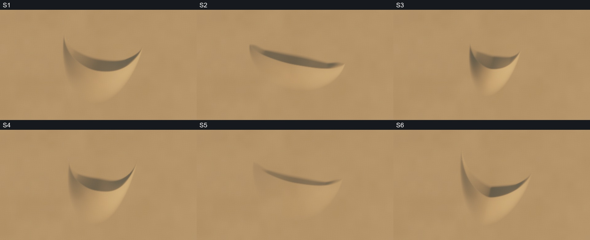
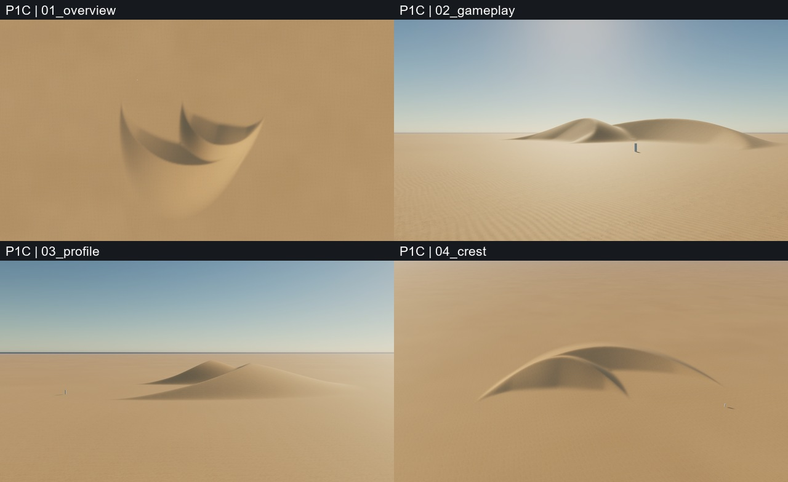
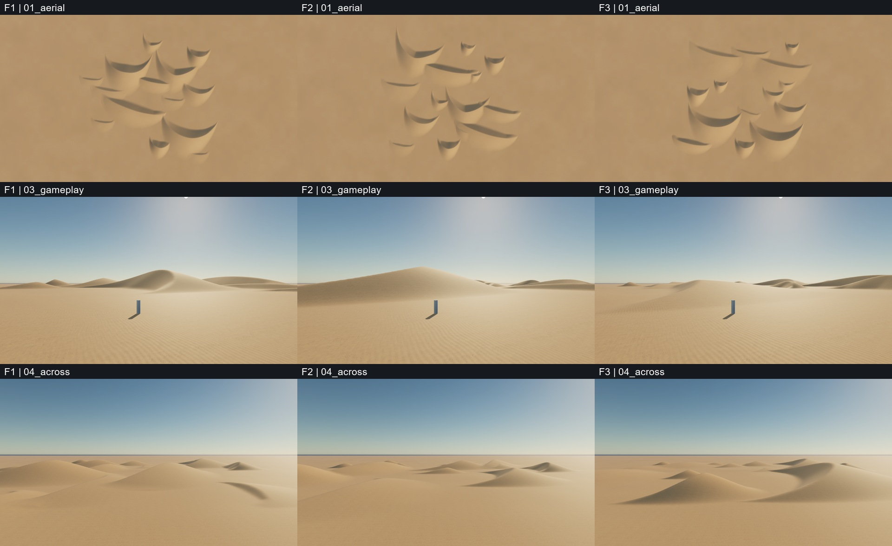

# M2 — Dune diversity and small dune fields

Development: **2026-11-01**. Published for independent visual review: **2026-11-02**.
Status: technical prototype tested; **M2 artistic approval pending**.

This review contains actual Unreal Engine screenshots, not AI concept images. Collages only resize and label those screenshots. The representative PNG was encoded as JPEG without cropping, retouching or colour adjustment. This public repository contains no game source, Unreal project, original asset packages or private project documentation.

## Review images

| Material | Image |
|---|---|
| Six dune silhouettes, same overhead camera and lighting | [six-dunes-overview.jpg](images/six-dunes-overview.jpg) |
| Six dunes from a 4.5 m gameplay-height camera | [six-dunes-gameplay.jpg](images/six-dunes-gameplay.jpg) |
| Two-dune merge: overhead, gameplay, side and crest views | [two-dune-merge.jpg](images/two-dune-merge.jpg) |
| Fields F1 / F2 / F3: overhead, gameplay, across ridges | [three-fields-comparison.jpg](images/three-fields-comparison.jpg) |
| F1 composition before / after revision 2 | [f1-before-after.jpg](images/f1-before-after.jpg) |
| Representative F1 revision 2 gameplay screenshot | [f1-gameplay.jpg](images/f1-gameplay.jpg) |

## What to evaluate

Please evaluate independently; the internal recommendation below is not an approval.

1. Are the six silhouettes meaningfully different, smooth and attractive? Identify overly pointed or mathematical-looking ends/crests.
2. Do the windward and leeward slopes remain readable at gameplay height?
3. Does the merged pair retain readable crests without an obvious seam or artificial stacked peak?
4. Which field has the best balance of large masses, supporting dunes, open valleys and coherent prevailing wind?
5. Does F1 revision 2 improve the overall composition? What is the most valuable next change within the existing 504 m test area?

Prioritize silhouette, flow, scale and composition over microtexture polish. The task deliberately favours elegant smooth dunes over noisy erosion. This is a small prototype, not the complete desert biome or a 10 km world.

## Six presets

All singles use seed **17** and wind direction **12 degrees**. These are generator parameters: length is the windward section length, not the full rotated footprint.

| ID | Shape | Height (m) | Width (m) | Length (m) | Horn length (m) |
|---|---|---:|---:|---:|---:|
| S1 | Broad crescent | 15 | 174 | 74 | 67 |
| S2 | Long flowing ridge | 13 | 212 | 56 | 13 |
| S3 | Compact barchan | 17 | 112 | 62 | 57 |
| S4 | Unequal crescent | 16 | 146 | 76 | 73 |
| S5 | Broad low dune | 7 | 198 | 86 | 24 |
| S6 | Long sweeping arms | 14 | 162 | 65 | 91 |

One parameterized family controls height, width, length, crest position/curvature, horn length/curvature/asymmetry, windward/leeward profiles, end taper and smoothness. No high-frequency terrain noise was added. The approved M1.1 A was the starting point; M1/M1.1 were preserved.

## Pair and field composition

**P1:** two different scaled presets contribute to one shared heightfield. A compact smooth maximum replaces height addition. The merged peak is **13.94 m**, versus **17.46 m** from naive addition. Smoothing uplift above a hard maximum is bounded to 0.45 m for this pair. No visible rupture was found in the reviewed views; this is not a claim that every possible parameter combination is artifact-free.

Each field is **504 x 504 m**, with **14 dune contributors** in three size tiers. All use a prevailing wind with bounded local variation. Layouts use curated massing anchors plus deterministic seeded variation, not a general-purpose biome planner.

| Field | Layout seed | Character |
|---|---:|---|
| F1, revision 2 | 101 | Linked crescent groups with open passages |
| F2 | 307 | Diagonal chains of elongated ridges |
| F3 | 809 | Broad basin and low supporting shoulders |

F1 revision 2 brings major masses closer and replaces three small accents with broad low forms. Earlier F1 remains visible in the before/after comparison. The internal recommendation is **F1 revision 2** for its mix of silhouette variety and low-camera depth. F2 obscures some distant forms behind the closest dune; F3 is calmer but has a weaker focal point.

## Technical results and limits

- 17 saved/reopened maps, including diagnostic lighting versions; two successive rebuilds produced identical numeric placements with no duplicate generated actors.
- 1 m Landscape sampling: 253 x 253 vertices / 16 components for singles and pair; 505 x 505 / 64 components for fields. Nanite remained disabled.
- 16 numeric controls tested for a measurable geometry change. Repeated generation is byte-identical in the tested environment; input instance order is stabilized by IDs. Cross-platform reproducibility was not tested.
- **751 actual collision probes**, maximum discrepancy from the encoded heightfield **0.02551 cm** (about 0.26 mm).
- 50 original screenshots were inspected locally. This publication deliberately selects six images instead of uploading the entire capture archive.
- 239 monitored files from earlier scenes/assets/prototypes retained their hashes. This was a protection set, not a whole-project hash.
- Settled static-camera captures: DX11 Editor Game, 1600 x 900, manual exposure, 60 FPS cap; p95 approximately **16.667 ms**, peak process memory **2581–2661 MiB**. Not a packaged build, moving-train test or measurement of GPU headroom.

Known weaknesses: idealized/repeating crescent motifs; sparse near foreground; fine shadow stepping on steep surfaces at 1 m resolution; regular close-up sand ripples; temporary flat studio horizon. S5 intentionally has weak hero readability. S2's far toe is outside the common low-camera frame; its full silhouette appears in the overhead view.

Recommended next step, subject to artistic approval: improve one camera route, foreground/midground composition and motion through F1 at the **same scale**. No full-biome expansion or railway integration is approved by this report.

[Resolved parameters, seeds and cameras](parameters.json) · [Technical summary](technical-summary.json) · [Image provenance and hashes](manifest.json)

The publication authorizes visual review, not redistribution of the game's original assets. No asset license is granted by this report.
