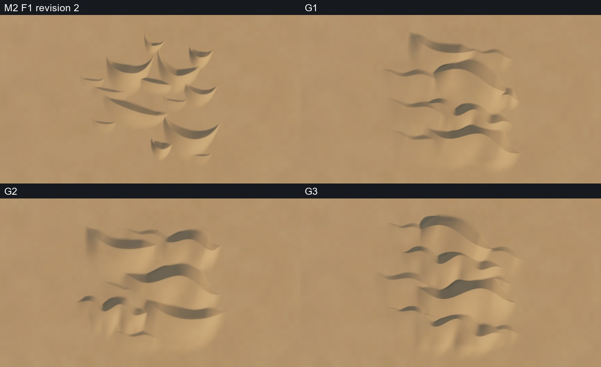
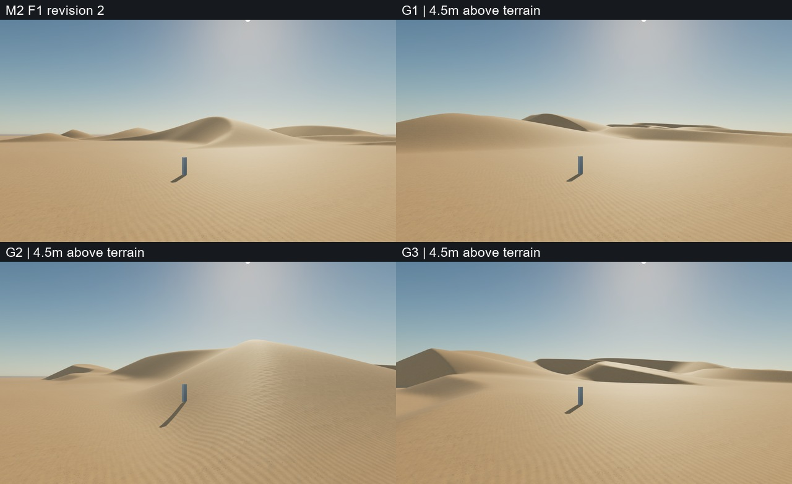

# M2.1 — crest diversity and terrain-aware dune fields

Development/review: 2026-11-02. **Awaiting the author's visual approval.** M2's technical foundation was accepted; F1 revision 2 remains an unchanged regression baseline. This milestone does not approve or generate a full dune biome.

## Review images

| Material | Image |
|---|---|
| M2 F1 baseline versus G1/G2/G3, identical aerial view | [Aerial comparison](images/fields-aerial.jpg) |
| Baseline versus G1/G2/G3, gameplay-height view | [Gameplay comparison](images/fields-gameplay.jpg) |
| Six new crest-shape examples | [Shape comparison](images/six-crest-shapes.jpg) |
| Three fields under neutral diagnostic lighting | [Neutral comparison](images/fields-neutral.jpg) |
| Three dunes on moderately uneven terrain | [Terrain test](images/uneven-terrain.jpg) |
| Two evidence-driven refinements | [Before / after](images/refinements.jpg) |

## Moving-camera sequences

[G1 fly-through](videos/G1-flythrough.mp4) · [G2 fly-through](videos/G2-flythrough.mp4) · [G3 fly-through](videos/G3-flythrough.mp4)

Each is a silent 8-second, 24fps sequence of 192 actual Unreal-rendered frames. All three use the same XY trajectory and 4.5m terrain-relative camera height, with a forward look-ahead. These are offline sampled camera sequences, **not real-time gameplay or performance demonstrations**. No Railway system is involved. They deliberately pass over the relief rather than following a railway-safe grade.

## What changed

- Extended the existing generator; retained M2's shared grid, height encoding and smooth composition operation. Original M2 generation and levels are unchanged.
- A smoothly varying crest supports bow, broad bend count/amplitude/phase, height modulation and skew, tapered ends and optional asymmetric horns. The examples are parameter configurations of one family, not hand-authored meshes.
- New height normalization is independent of the sampled window. There is no high-frequency geometry noise or erosion simulation.
- One shared Landscape combines the smooth base relief and dune contributions. Downwind base slope adjusts slip-face runout. Compact smooth maximum avoids naive addition of complete dune heights; its bound is per pairwise merge, not a universal bound for arbitrarily many overlaps.
- G1/G2/G3 use 9/8/10 dune masses respectively, with larger linked ridges, small shoulders and open areas. They are curated massing arrangements with deterministic variations, not a general-purpose biome placement solver.

| Case | Intent |
|---|---|
| S1 | Long sinuous ridge |
| S2 | Broad bowed crest |
| S3 | Several gentle crest bends |
| S4 | Unequal hooked ridge with height asymmetry |
| S5 | Low sand shoulder for transitions |
| S6 | Tall tapering transverse ridge |
| G1 | Linked sinuous ridges and low connecting shoulders |
| G2 | Larger dune bodies surrounding open valley space |
| G3 | Long undulating transverse bands |
| T1 | Three merged masses on a shared non-flat substrate |

Full resolved positions, parameters, seeds, cameras and height hashes: [parameters.json](parameters.json). Fields remain **504 × 504m**, 505 × 505 samples; singles and T1 use 252 × 252m, 253 × 253 samples. Both use 1m spacing. A 2m column provides scale. Camera XY, target and FOV are consistent across field comparisons; gameplay camera Z is adjusted to maintain 4.5m above each terrain. Original M2 captures are reused without regenerating the baseline.

## Visual findings and refinements

The new cases show longer and more varied crest lines than the repeated C-shaped M2 layout. Low masses and substrate relief connect the field more convincingly. The neutral images expose the geometry without the sand material.

Review scope: selected real static screenshots/comparison sheets and eight evenly distributed frames from each moving-camera sequence were visually inspected. All 192 frames per sequence are distinct and present; collision clearance is checked for every frame. This is not a claim that every frame was manually watched in continuous playback. The sampled views reveal substantial camera pitch changes on steep slopes and the empty studio horizon near the route end.

Two problems were found in actual Unreal screenshots and addressed:

1. The first substrate fade produced a conspicuous rectangular raised apron. Replacing the minimum-distance boundary fade with a smooth separable substrate support removes the sharp corner creases and softens the perimeter. The before/after comparison uses unchanged cameras and lighting.
2. G2's near crest showed repetitive triangular shadow/mesh steps. Increasing its geometry smoothing from 2 to 12 stencil passes softened the crest, but **did not fully remove this artifact**. The comparison intentionally includes the remaining defect. More rounding trades away the crisp slip face, so this is not declared solved.

Remaining limitations: some ends remain pointed; the analytic shapes are idealized; the 1m grid and grazing shadows reveal discretization; fine sand ripples remain regular; close foreground and the flat studio horizon are not production-ready. Base relief is deliberately modest, not an arbitrary steep-terrain placement solution. The sampled camera's pitch follows terrain and is not a finished train camera. There is no material or wind-FX improvement claim in this geometry milestone.

## Technical evidence and limits

- 14 saved maps reopened; each contains one Landscape and the expected component/camera counts.
- Two consecutive regeneration passes on G1C (505²) and T1C (253²) preserve actor transforms/counts and produce no duplicate generated labels. Other maps were saved/reopened and collision-tested; they were not all independently double-regenerated.
- All 10 heightfields reproduce exactly, including reordered instance input. Numeric control tests change geometry. Finite-difference checks, zero borders, substrate contact and component-seam collision samples pass for the delivered configurations.
- M2 P1 and F1 recorded height hashes reproduce exactly through the unchanged M2 generator. This verifies preservation of the existing pair composition and baseline.
- 1,176 Landscape collision probes across the new maps; see the precise maximum error in [technical-summary.json](technical-summary.json).
- 305 protected prior assets/scripts retain their hashes. Existing gameplay, Railway, S01/S02, earlier dune maps and original materials are preserved.
- Moving-camera review checks terrain clearance on every captured frame. The report separates capture-overhead timings from static camera timings.

Static runtime samples are Editor Game DX11 at a 60fps cap, not packaged/GPU/full-world benchmarks. Initial G1/G2/T1 passes measured p95 approximately 103.7/115.3/164.9ms. Later measurements are included separately in the technical summary; the cause of the early variability was not isolated. Do not infer guaranteed stable gameplay from capped static captures.

## What to evaluate

Recommendation: **G3** is the strongest candidate for the next low-camera composition review: its near, middle and distant ridge layers read more clearly than G1's relatively empty foreground, while G2's large near mass hides much of the field. G1 remains useful as the more varied sinuous-ridge reference. This is a recommendation, not artistic approval; M2 F1 revision 2 remains the preserved regression baseline.

1. Are the new crests meaningfully varied while retaining a smooth sand style?
2. Do the larger and smaller forms read as a coherent landscape rather than separate stamps?
3. Which of G1/G2/G3 provides the strongest layered view from low camera height?
4. Are the remaining pointed ends, crest steps or regular ripples unacceptable at this stage?
5. Does the motion reveal additional continuity or camera issues?

After visual approval, the next proposed task is a **small corridor test using the existing spline-based Railway system**. A separate early test must validate loaded-track references and stable GUIDs under World Partition unload/reload. No Railway integration, world expansion, additional biome, Niagara effect or original-asset modification was performed here.

This repository contains only review artifacts and safe artistic parameters, not game/generator source code or original asset packages.
