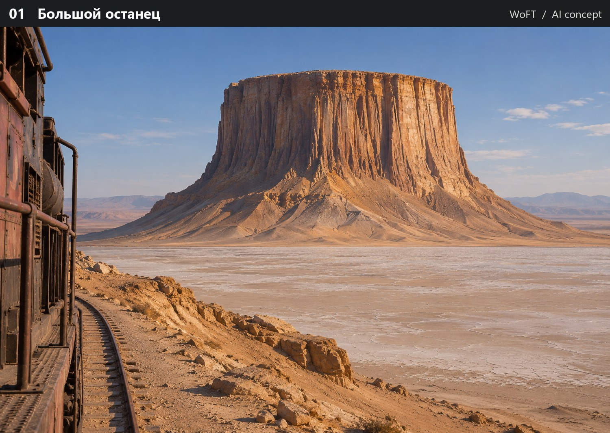
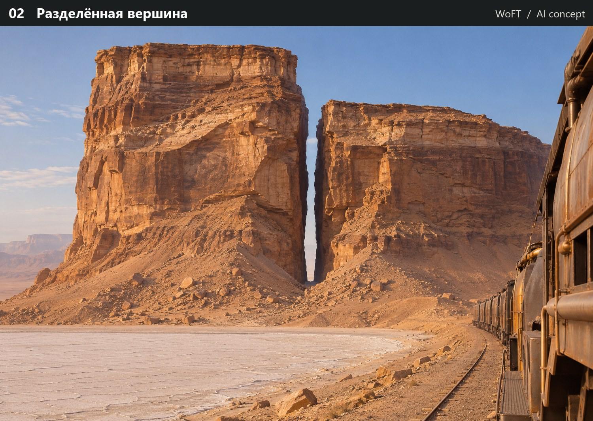
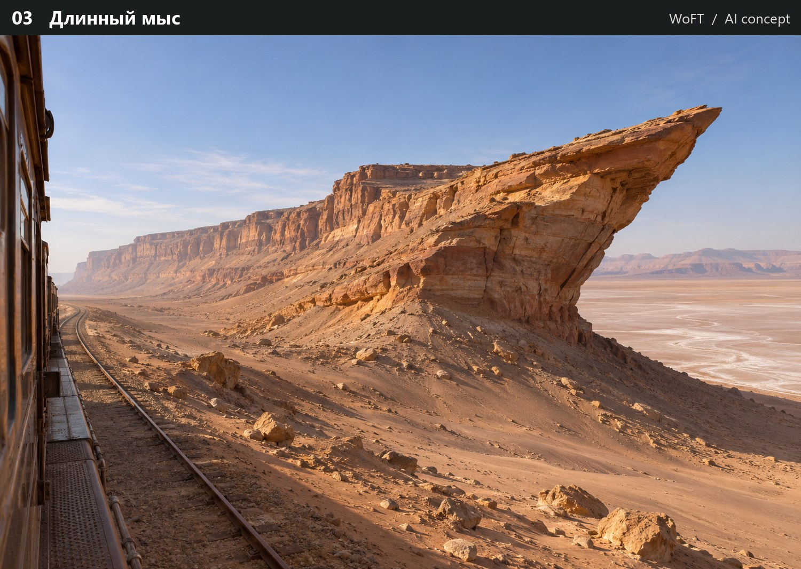
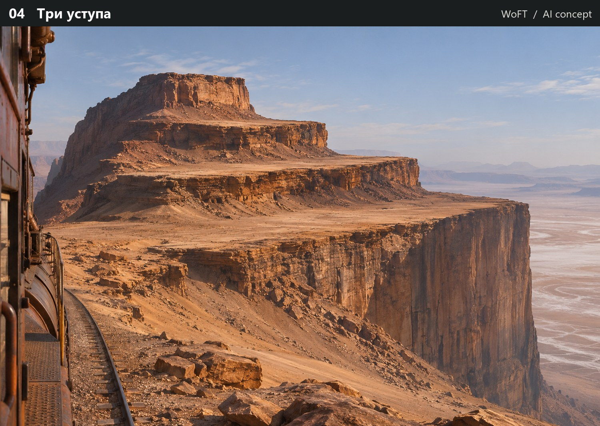
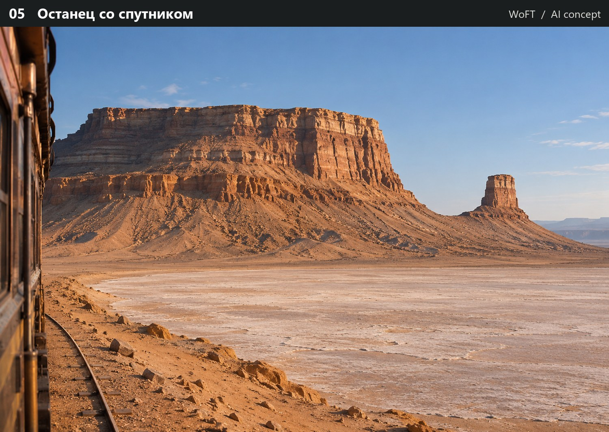
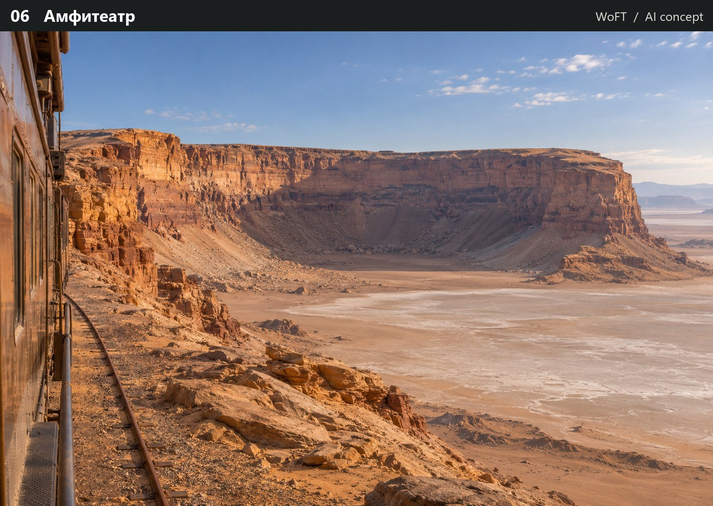
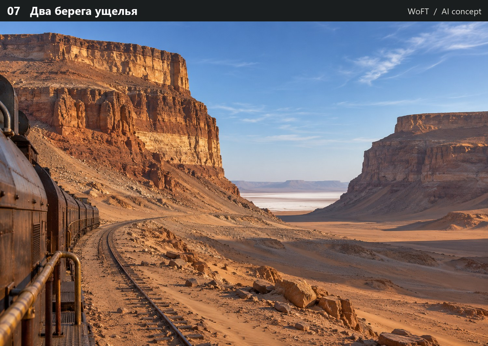
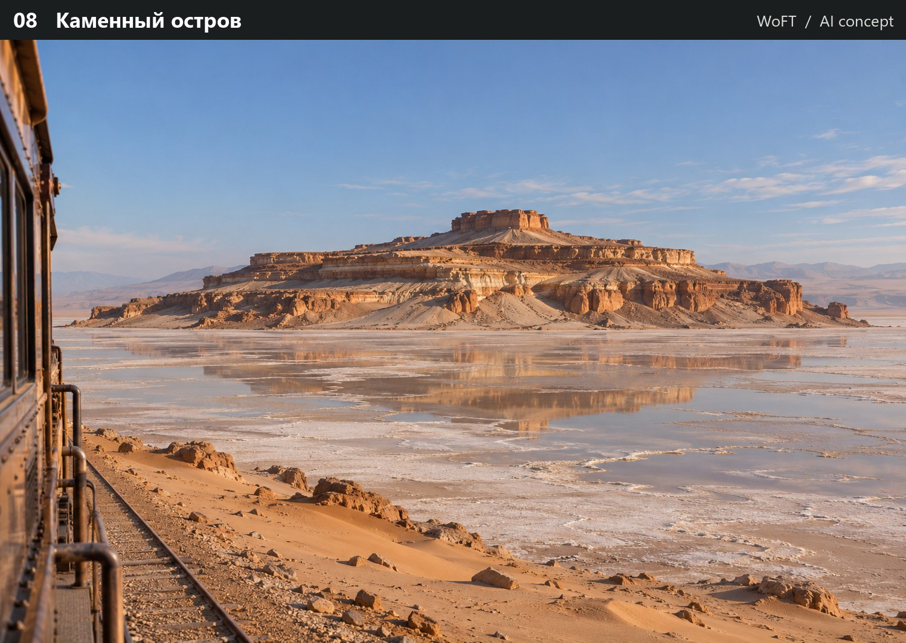
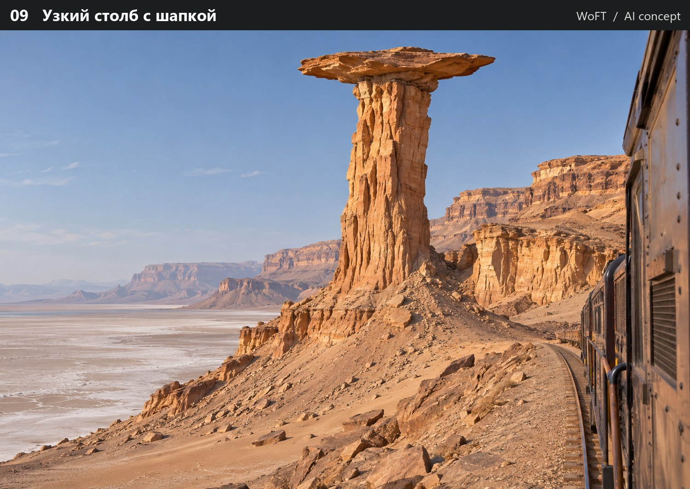
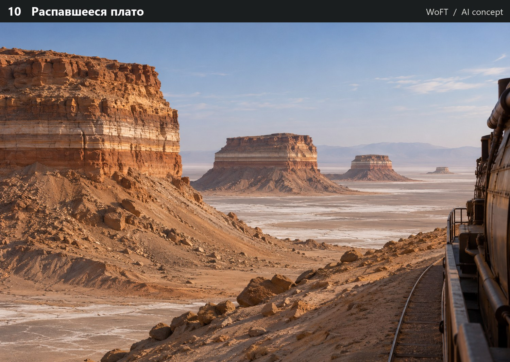

# WoFT · Десять силуэтов столовых гор

Фотореалистичные ИИ-эскизы для выбора геометрии будущего генератора. Поезд, материалы, освещение и железная дорога на этих изображениях служат художественными ориентирами. Первые игровые кадры Unreal доступны в [Monument12](../Monument12/README.md).

### 01 · Большой останец

### 02 · Разделённая вершина

### 03 · Длинный мыс

### 04 · Три уступа

### 05 · Останец со спутником

### 06 · Амфитеатр

### 07 · Два берега ущелья

### 08 · Каменный остров

### 09 · Узкий столб с шапкой

### 10 · Распавшееся плато

