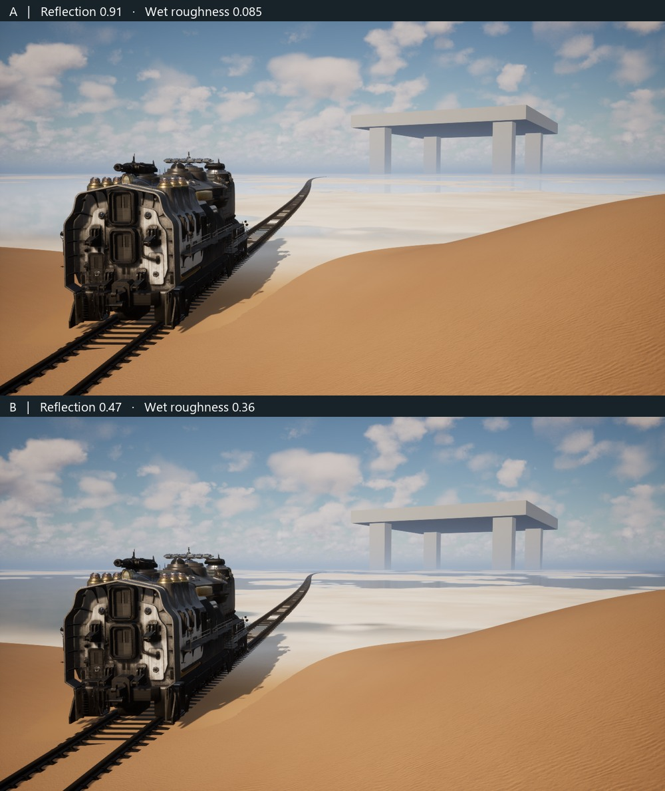

# Shore 01 · Live wet-salt controls

7 November 2026. Two independent material controls on the original Shore 01 map. At the 735 m marker, A preserves the earlier wet material. B produces darker, softer reflections between the light dry salt islands.

[Original PNG A](images/A.png) · [Original PNG B](images/B.png) · [Continuous drive with B](B-drive.mp4)

| Preset | Reflection strength | Wet roughness |
|---|---:|---:|
| A | 0.91 | 0.085 |
| B | 0.47 | 0.36 |

In the live-controls launch, open the Unreal console and enter `shore.Salt A` or `shore.Salt B`. For individual changes use `shore.Salt strength 0.65` and `shore.Salt roughness 0.22`. Each accepts values from 0 to 1. The roughness sets surface roughness and softens the captured sky reflection above the original 0.085.

The paired PNGs use one loaded world and one dynamic material instance. The train, camera, exposure, sun and cloud phase were held fixed. A strength-only intermediate frame and parameter readback verified each control independently. The wet area responded to both changes. In the control sky and dune patches all mean RGB pixel differences stayed within one 8-bit level for each individual change.

Initial setup through A took 412.6 s. The first pair was ready after 415.5 s from the start of work. Switching from the saved A to the saved B took 2.91 s, including the intermediate check, with zero map reloads. The original Shore 01 report has no comparable start-to-frame measurement.

The B drive covered 1121 m in 32.0 s. Both tests used editor-game DX11, Mammoth, the same route, camera, 1440×810 window and 60 fps cap. B frame time reached 37.99 ms at p95 and 42.40 ms at maximum. The previous single run measured 37.90 ms at p95. The silent capture contains 647 source frames in 749 encoded frames. The mirror updates at 15 Hz. Artistic selection remains open.
